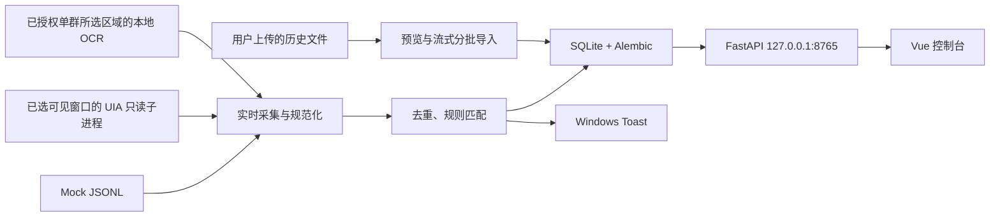

# 架构

- `backend/app/adapters` 定义采集及导入接口。Mock 的游标和已提交消息同事务写入。UIA 待提交快照仅保存在内存，入库成功后才推进基线。
- `backend/app/services/live.py` 在工作线程轮询。UIA 查询与 OCR 识别在有超时的子进程中运行。OCR 识别前验证窗口、选区和群标题，验证通过的新增文字复用现有的增量快照、匹配与入库。采集失败保留应用内诊断。
- `backend/app/services/ingest.py` 优先用来源稳定 ID。没有稳定 ID 时使用源、会话、发言人、内容、原始时间秒级摘要及 120 秒观测窗口。缺少原始时间时，相同文字可能在窗口内误合并。多条规则命中聚合为每消息一次通知。
- `backend/app/services/history.py` 每 500 行提交暂存批次数据，检索仅显示已完成批次。取消、失败和启动时检测到的中断会清除相应消息及索引。重复记录归首次完成的批次。
- `backend/app/db/migrations` 管理 SQLite 模型和索引。使用 WAL、外键、忙等待和 secure_delete。支持 FTS5 trigram 的环境使用全文索引，短词及不支持索引的环境使用有结果上限的字面子串查询。
- `backend/app/api` 实现 `/health` 及 `/api/v1`。JSON 使用 `{data,error,request_id}`，CSV/JSONL 导出和 SSE 使用流响应。SSE 仅包含刷新序号，页面收到事件后重新读取受保护的 API。
- `frontend/src` 包含中文控制台、Pinia 运行状态、Vue Router 导航及 Element Plus 控件。生产构建与 API 同源，开发模式经 Vite 回环代理。
